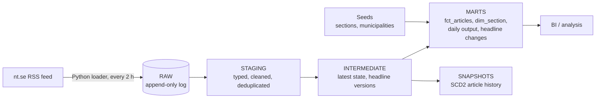

# NT News Pipeline

[](https://github.com/simonabisiani/nt-news-pipeline/actions/workflows/ci.yml)

An ELT pipeline that collects the local news feed from Norrköpings Tidningar ([nt.se/rss/lokalt](https://www.nt.se/rss/lokalt)) every two hours, loads it into Snowflake and models it with dbt into tested, documented tables for analysis.

It answers questions such as:

- How many articles does NT publish per day, per section and per municipality?
- How much of the feed is automated, template-generated content (company registrations, property sales) versus editorial journalism?
- Which headlines are edited after publication, and how?
- Is collection running as it should, or have runs been missed?

## Architecture



| Layer | Contents | Materialization |
|---|---|---|
| `RAW` | One row per item per fetch, untouched. Written by `loader/load_feed.py`. | table (append) |
| `STAGING` | `stg_nt__feed_items`: renamed, typed, HTML stripped, dates parsed to UTC, section parsed from the URL, duplicates within a fetch removed. | view |
| `INTERMEDIATE` | `int_articles__latest`: one row per article. `int_articles__headline_versions`: every headline an article has had. | view |
| `MARTS` | `fct_articles` (incremental), `dim_section`, `mart_daily_output`, `mart_headline_changes`. | table |
| `SNAPSHOTS` | `snap_articles`: type 2 history of headline and intro. | snapshot |

## Data quality

Tests run on every build (`dbt build`). The fixtures in `tests/fixtures/` contain deliberate errors so each check is exercised in CI.

| Check | Type | Catches | Severity |
|---|---|---|---|
| Source freshness on `fetched_at` | freshness | Loader has stopped | warn 6 h, error 24 h |
| `unique`, `not_null` on keys | generic | Duplicates, missing IDs | error |
| `relationships` fct → dim → seed | generic | Orphaned sections and municipality codes | error |
| `accepted_values` on `content_type` | generic | Unexpected categories | error |
| `not_null` on `published_at` | generic | Missing or unparseable dates | warn |
| `assert_all_sections_mapped` | singular | New sections not yet in `seeds/sections.csv` | warn |
| `assert_no_collection_gaps` | singular | More than 6 h between loader runs | warn |
| `assert_published_before_collected` | singular | Timestamps that make no sense | error |

Unmapped sections are kept and labelled `unmapped` rather than dropped, so new content never silently disappears from reporting.

## Design decisions

- **Append-only raw log.** The loader stores every fetch without cleaning. This keeps the source reproducible and is what makes headline-change detection and gap monitoring possible.
- **Two kinds of history.** `int_articles__headline_versions` rebuilds headline history from the full log. `snap_articles` uses dbt snapshots (SCD2) for headline and intro. The log-based version also captures changes made between runs.
- **Incremental fact table.** `fct_articles` only reprocesses articles seen since the last run and upserts on `article_id`.
- **Curated mapping as seeds.** Sections, content type and municipality codes live in version-controlled CSV files, so changes go through pull requests and review.
- **Least-privilege roles.** `LOADER` can only insert into RAW, `TRANSFORMER` (dbt) builds downstream layers, `REPORTER` can only read MARTS.
- **Cost control.** An XS warehouse that suspends after 60 s, and a resource monitor that suspends it at the monthly credit quota.
- **Runs locally without Snowflake.** A few adapter-dispatched macros (`macros/cross_db.sql`) let the same models run on DuckDB for development and CI.
- **Responsible collection.** Only feed metadata and intros are stored, the loader identifies itself with a user agent and polls every two hours.

## Getting started locally

```bash
python -m venv .venv && source .venv/bin/activate
pip install -r requirements.txt
export DBT_PROFILES_DIR=.

# Option A: synthetic test data (no network)
bash scripts/load_fixtures.sh

# Option B: the live feed
python loader/load_feed.py --target duckdb

dbt build                       # seeds, models, snapshots and tests
dbt source freshness
dbt docs generate && dbt docs serve   # documentation and lineage graph
```

## Running on Snowflake

1. Create a trial account and run `snowflake/setup.sql` in a Snowsight worksheet.
2. Generate one key pair per service user and paste the public keys into `setup.sql`:
   ```bash
   openssl genrsa 2048 | openssl pkcs8 -topk8 -inform PEM -out loader_key.p8 -nocrypt
   openssl rsa -in loader_key.p8 -pubout -out loader_key.pub
   # repeat for dbt_key.p8
   ```
3. Set environment variables and run:
   ```bash
   export SNOWFLAKE_ACCOUNT=<org-account>
   export SNOWFLAKE_LOADER_USER=SVC_LOADER SNOWFLAKE_LOADER_PRIVATE_KEY_PATH=loader_key.p8
   export SNOWFLAKE_DBT_USER=SVC_DBT SNOWFLAKE_DBT_PRIVATE_KEY_PATH=dbt_key.p8
   export DBT_TARGET=prod RAW_SCHEMA=RAW

   python loader/load_feed.py --target snowflake
   dbt build
   ```

## CI/CD

- `.github/workflows/ci.yml`: on every pull request, builds and tests the project on DuckDB with fixtures and publishes the docs as an artifact.
- `.github/workflows/scheduled_load.yml`: every two hours, loads the feed into Snowflake, checks freshness and runs `dbt build`. Needs the secrets `SNOWFLAKE_ACCOUNT`, `SNOWFLAKE_LOADER_PRIVATE_KEY` and `SNOWFLAKE_DBT_PRIVATE_KEY`.
- `azure-pipelines.yml`: the same pull-request check for Azure DevOps.

## Project structure

```
loader/load_feed.py          Extract + load (stdlib only, plus DuckDB/Snowflake drivers)
snowflake/setup.sql          Warehouse, schemas, roles, service users, resource monitor
models/staging/              Sources, freshness, stg_nt__feed_items
models/intermediate/         Latest state and headline versions per article
models/marts/                fct_articles, dim_section, daily output, headline changes
snapshots/                   SCD2 history of articles
seeds/                       Section mapping and Östergötland municipality codes
macros/                      Cross-database helpers, schema naming
tests/                       Singular data tests and synthetic fixtures
```

## Possible next steps

- Add more feeds (other NTM titles, Corren, SVT Öst) and an outlet dimension.
- Slim CI with `dbt build --select state:modified+` against the production manifest.
- A Power BI or Streamlit dashboard on top of `MARTS`.
- Classify articles by municipality mentioned in the text, not only the URL section.
